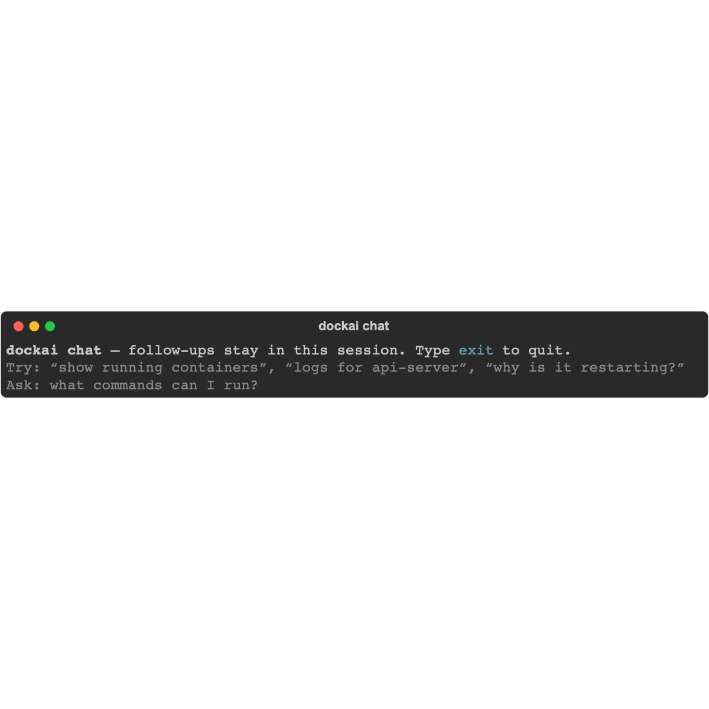

# dockai

Talk to your Docker Engine in plain English — or use fast direct commands with no model at all.

**Your daemon. Your model. No account, no usage limits, no Docker Desktop.**

[](#1-prerequisites)
[](#1-prerequisites)
[-black)](#1-prerequisites)
[](#why-dockai)

## Why dockai

- **Runs fully offline.** Inference stays on your machine (Ollama) or your own GPU box. Pull a model once, then work air-gapped.
- **No account, no plan, no usage meter.** Nothing phones home to run a query.
- **No Docker Desktop.** It talks to the Docker Engine API, so plain Docker Engine on Linux, Colima, or Desktop all work.
- **Fast path first.** Common asks ("show running containers", "logs for api-server") are resolved by a local intent pipeline in ~100–300 ms — the model never runs.
- **Never executes model output.** Only a fixed set of Docker tools is callable; `start` / `stop` / `restart` / `exec` are proposed and confirmed, and delete/prune are refused.
- **Reads real Docker state.** Tables, uptimes, and diagnosis come from inspect + logs, not from the model's imagination.

## How it compares to Docker AI (Gordon)

Docker's built-in agent is a good product. It is also a signed-in, plan-metered, Desktop-first, service-backed one. dockai is the opposite trade-off:

| | **dockai** | **Docker AI (Gordon)** |
|---|---|---|
| Where inference runs | Your machine — local Ollama, or a remote GPU host you own | Docker's AI service |
| Works offline / air-gapped | Yes, after the model is pulled | No |
| Account and plan | None | Docker account; usage limits |
| Docker Desktop required | No — any reachable Docker Engine | Desktop 4.74+ (`docker ai` for the CLI) |
| Deterministic no-LLM path | Yes — `shortcut:list`, `shortcut:logs`, … | Model decides every turn |
| Model choice | `qwen2.5:3b`, `llama3.1:8b`, anything tool-capable | Docker-selected |
| Cost | Free; compute is yours | Plan-based |
| Model output → shell | Never; fixed tool registry | Docker commands, run after approval |
| Destructive operations | delete / prune refused outright | Broader action surface |
| Scriptable | Direct CLI and one-shot prompts | Interactive TUI / Desktop |

**Where Gordon is ahead:** images, volumes, networks, Dockerfile review/authoring, and docs search. dockai is deliberately narrow — containers, logs, uptime, and diagnosis — because that is the part a local model can be trusted with.

*Comparison reflects public Docker docs as of October 2026. Docker AI moves fast; check [docs.docker.com/ai/gordon](https://docs.docker.com/ai/gordon/) for the current feature set.*

## 60-second demo

```console
$ dockai "show running containers"        # 132 ms — local intent, no model call
$ dockai "show its last 25 log lines"     # session focus carries the container
$ dockai "why is api-server restarting?"  # inspect + log scan first, facts before guesses
$ dockai stop api-server                  # shows impact, then asks to confirm
```

Stage timings always tell you which path ran:

```text
# NL shortcut (typically ~100–300 ms)
Completed in 132 ms
  · shortcut:list: 108 ms

# LLM path (seconds — the model chose the tool)
Completed in 9.2s
  · ollama #1: 9.1s
  · docker list_containers: 128 ms
```

## Install (clone → first command)

### 1. Prerequisites

| Need | Why | Check |
|------|-----|--------|
| **Git** | Clone the repo | `git --version` |
| **Python 3.11+** | Runtime | `python3 --version` |
| **Docker Engine** | Container source of truth | `docker ps` (must work **without** sudo for your user) |
| **Ollama** | Natural-language mode only | `ollama --version` |

- Docker: install [Docker Desktop](https://www.docker.com/products/docker-desktop/) (Mac/Windows) or Docker Engine (Linux). Start it, then confirm `docker ps` works. Any Engine the Docker SDK can reach is fine.
- Ollama: install from [https://ollama.com](https://ollama.com), then start it (`ollama serve` if it is not already running).
- You do **not** need Ollama for `dockai containers`, `logs`, `stop`, etc.

### 2. Clone and install

```bash
git clone git@github.com:saroj990/dockAI.git
cd dockAI

./scripts/setup.sh      # venv + durable install (not fragile editable)
./scripts/link-cli.sh   # symlink ~/.local/bin/dockai — no activate needed
```

HTTPS alternative for the clone:

```bash
git clone https://github.com/saroj990/dockAI.git
```

Open a **new** terminal (or `source ~/.zshrc`), then from any directory:

```bash
dockai chat
dockai containers
```

With `link-cli.sh` you should **not** need `source .venv/bin/activate`. The linked launcher auto-repairs a broken install.

If you see `No module named 'dockai'`, you are likely hitting an old `.venv/bin/dockai` on PATH — run `./scripts/link-cli.sh` and prefer `~/.local/bin/dockai`. Avoid `pip install -e` unless you are developing; use `./scripts/setup.sh` to reinstall.

**Developers** (live code reload):

```bash
./scripts/setup.sh --editable
```

Re-run `./scripts/setup.sh` (without `-e`) if editable install breaks again.

### 3. Config file (recommended)

```bash
cp dockai.example.toml dockai.toml
```

Edit `dockai.toml` and set a model you will actually pull (example for speed):

```toml
[ollama]
host = "http://127.0.0.1:11434"
model = "qwen2.5:3b"    # must match `ollama list`
timeout = 120

[docker]
timeout = 60

[diagnostics]
verbose = false
```

Show what dockai will use:

```bash
dockai config
```

**Config search order:** `DOCKAI_CONFIG` → `./dockai.toml` → `~/.config/dockai/config.toml`  
**Precedence:** CLI flags > environment variables > config file > defaults

| Setting | Config | Environment | CLI |
|---------|--------|-------------|-----|
| Ollama host | `[ollama] host` | `OLLAMA_HOST` | — |
| Model | `[ollama] model` | `DOCKAI_MODEL` | `--model` |
| Ollama timeout | `[ollama] timeout` | `DOCKAI_OLLAMA_TIMEOUT` | — |
| Docker timeout | `[docker] timeout` | `DOCKAI_DOCKER_TIMEOUT` | — |
| Verbose logs | `[diagnostics] verbose` | `DOCKAI_DEBUG=1` | `-v` / `--verbose` |
| Chat welcome hints | `[diagnostics] chat_hints` | `DOCKAI_CHAT_HINTS=0` | — |
| Config path | — | `DOCKAI_CONFIG=/path/to.toml` | `--config` |

Env vars are **optional** if `dockai.toml` is set. Use them only to override without editing the file.

### 4. Pull the model (NL mode)

The model name in config **must** exist locally:

```bash
ollama pull qwen2.5:3b          # or whatever you set in dockai.toml
ollama list                     # confirm the name matches exactly
curl -s http://127.0.0.1:11434/api/tags | head  # API reachable?
```

Other workable options: `llama3.1:8b` (higher quality, slower), `gemma3:4b` (faster, weaker tools).

### 5. Smoke test

```bash
# 1) Docker-only (fastest — no Ollama)
dockai containers

# 2) NL shortcut (no Ollama; look for shortcut:list in timings)
dockai "show running containers"

# 3) Interactive
dockai chat
```

If `dockai` is not on PATH (you skipped `link-cli.sh`), run `source .venv/bin/activate` from the checkout first, or call `./scripts/link-cli.sh`.

---

## Features

**Full catalog:** [docs/FEATURES.md](docs/FEATURES.md) — commands, NL shortcuts, troubleshooting, Ollama/fallback, safety, and performance paths.

Examples below assume `dockai` is on PATH (via `link-cli.sh`). Add `source .venv/bin/activate` if you are running from a checkout without the launcher.

### Direct CLI (no LLM)

Fast path — talks to Docker only.

```bash
dockai containers                 # running only
dockai containers --all           # include stopped/exited
dockai uptime
dockai uptime --all
dockai search flink
dockai search flink --running-only
dockai inspect timescaledb
dockai logs timescaledb           # last 100 lines
dockai logs timescaledb -n 25
dockai logs timescaledb --full
dockai start api-server           # proposes, then confirms
dockai stop api-server
dockai restart api-server
dockai config                     # resolved host/model/timeouts
dockai -v containers              # diagnostic tool logs
```

One-shot NL without entering chat:

```bash
dockai ask "show running containers"
dockai "show running containers"          # same as ask when given a prompt
dockai ask --model qwen2.5:3b "list uptime"
```

### Interactive chat

```bash
dockai chat
```

On start, `dockai chat` prints a short dim hint block (example phrases + how to list commands). Turn it off with `[diagnostics] chat_hints = false` or `DOCKAI_CHAT_HINTS=0`.



Follow-ups stay in one session (focused container, pending confirmations). Type `exit` to quit.

```text
You: show running containers
You: only name and uptime
You: show its last 25 log lines    # uses focused container when exactly one is in focus
You: stop that container           # still asks for confirmation
```

### List scope (running / all / exited / stopped)

Server-side intent + shortcuts enforce scope so the table matches what you asked for:

```bash
dockai "show running containers"           # running only
dockai "show me only running containers"
dockai "show me exited containers"         # exited only (not running)
dockai "show stopped containers"           # exited + dead
dockai "list all containers"               # full inventory
dockai "uptime of running containers"
```

`all_containers=true` alone is not “exited only” — dockai applies a `status` filter when you ask for exited/stopped/dead.

### Columns and table-first

Supported columns: `id`, `name`, `status`, `image`, `uptime`, `restarts`.

```bash
dockai "only name and uptime of running containers"
dockai "show ID, status, and name in a table"
dockai "can you pull only name and uptime of running containers"
```

After a successful list/uptime/search/logs/inspect tool call, dockai **table-first** renders Docker data and skips a second Ollama summary.

### Local intent first (skip Ollama)

NL turns run a **local intent pipeline** before Ollama: normalize filler → classify intent → extract slots → run the tool when confidence is high. Timings show `shortcut:…` (not `ollama #1`).

```bash
dockai "show running containers"
dockai "show me exited containers"
dockai "show me uptime of running containers"
dockai "show last 25 lines of timescaledb logs"
dockai "logs for timescaledb"
dockai "show me logs for timescaledb"   # same as above — filler stripped locally
dockai "can we see logs for pg_tileserv"
dockai "can we have logs for pg tileserv"  # spaces in name OK (resolved like hyphens)
dockai "find containers named postgis"
dockai "inspect timescaledb"
dockai "show me details for postgis"
dockai "stop api-server"              # still confirms before apply
```

Shared normalize strips politeness and soft verbs (`please`, `can we`, `show me`, `see`, `have`, `let me`, …) then matches structural shapes like `logs for <name>`. Trailing `containers` on log targets is dropped. Typos like `runnning` → `running` are fixed before matching.

**Still uses Ollama** (diagnosis / vague asks):

```bash
dockai "why is my container restarting?"
dockai "what looks unhealthy?"
dockai "which of these look stuck?"
```

**Log troubleshooting** (`dockai ask` / `dockai chat`): for diagnosis asks (`why…`, `what's wrong…`, restarting/failing), the agent **must** call `troubleshoot_container_logs` before any diagnosis text. Invented tool JSON / fake `docker_exec` stories are rejected and retried. The tool inspects state, scans recent logs for signals (errors, OOM, panics, tracebacks), then Ollama may summarize facts vs hypotheses. Plain log tailing still uses `dockai logs` or local intent shortcuts.

**docker exec**: the model may call `exec_in_container`, which only **proposes** a command. The CLI asks `Run this docker exec command?` before anything runs (same confirm pattern as start/stop/restart).

### Name resolution (spaces, hyphens, typos)

Resolve accepts flexible names for inspect / logs / start / stop / restart:

| You type (CLI or model `target`) | Behavior |
|----------------------------------|----------|
| `saien-backend-api` | Exact match |
| `saien backend api` | Separators ignored (`saienbackendapi`) |
| `saen-backend-api` / `saie-backend-api` | Close typo → one clear match is used |
| Several near matches | Ambiguous — lists candidates; you choose |
| Short junk (`apo`) / unrelated (`redis-cache`) | Not found (no unsafe guess) |
| Hex-like IDs | Exact ID match only — never fuzzy to a name |

Examples:

```bash
dockai inspect "saien backend api"
dockai logs saen-backend-api -n 25
dockai "show logs for saen-backend-api"
```

Fuzzy matching is conservative: min name length, max edit distance 2, similarity threshold, and **no auto-pick** when two containers are equally close.

### Session focus

When a turn resolves to exactly one container, chat remembers it for follow-ups:

```text
You: inspect timescaledb
You: show its last 25 log lines
```

If several containers were listed, focus clears and dockai will ask which one you mean.

### Safe mutations

```bash
dockai stop api-server
# → shows name / id / status / impact
# → Confirm? only then calls Docker
```

Same for `start` and `restart` via CLI or NL (`dockai "stop api-server"`).

### Restricted actions

These are refused clearly (**Not supported**) — dockai will not substitute `stop` for delete:

```bash
dockai "delete the api-server container"
dockai "docker system prune"
dockai "quit Docker Desktop"
```

### Remote Ollama (optional)

Point `[ollama] host` at another machine (e.g. GPU box). Use **one** `model =` line — TOML cannot define the same key twice.

```toml
[ollama]
host = "http://100.x.x.x:11434"
model = "qwen2.5:7b"
timeout = 120
```

Docker still uses **your local** Docker Engine unless you change the Docker socket separately.

---

## Performance notes

| Path | Typical speed | When |
|------|---------------|------|
| Direct CLI (`dockai containers`) | ~`docker ps` speed | Sparse Docker list API (not full inspect) |
| **NL shortcut** | ~`docker ps` + tiny match cost | Common phrases (see Features) |
| Table-first after Ollama | ~one model call | LLM picks tool; skip summary |
| Full LLM | many seconds | Troubleshooting / vague asks |

- Direct commands ≈ `docker` speed.
- NL cost is mostly **Ollama**, not Docker — unless a shortcut matches (`shortcut:list` / `shortcut:logs` in timings).
- **Table-first:** list / uptime / search / logs / inspect skip the second Ollama summary.
- **Column intent:** “only name and uptime” is applied to the Rich table (not a fixed full column set).
- **List scope:** running / exited / stopped filters are enforced even if the model passes the wrong `all_containers` flag.

---

## Safety

- Only predefined tools (no shell execution of model output).
- start / stop / restart require explicit confirmation.
- Facts come from Docker, not model invention.
- delete / prune / Docker Desktop control → clear **Not supported** refusal.
- Name typos: close-match only with strict thresholds; ambiguous → ask; IDs never fuzzy-matched to names.
- Offline by default: with a local Ollama host, no query or container data leaves the machine. Point `[ollama] host` elsewhere only when you mean to.

---

## Common setup mistakes

| Problem | Cause | Fix |
|---------|--------|-----|
| `dockai: command not found` | venv not activated, or install skipped | `./scripts/setup.sh` then `./scripts/link-cli.sh`; or `source .venv/bin/activate` |
| `No module named 'dockai'` | Broken editable install or old `.venv` script on PATH | `./scripts/setup.sh && ./scripts/link-cli.sh` then use a new terminal (`which dockai` → `~/.local/bin/dockai`) |
| `Docker Engine is unavailable` | Docker not running / no socket permission | Start Docker Desktop; re-check `docker ps` |
| Ollama connection errors | Ollama not running or wrong host | `ollama serve`; set `host` in `dockai.toml` |
| Model not found / bad tool calls | Config model ≠ pulled model | `ollama list` and match `[ollama] model` exactly |
| `TOMLDecodeError: Cannot overwrite a value` | Duplicate key (e.g. two `model =` lines) | Keep a single `model` / `host` under `[ollama]` |
| `python: command not found` / need 3.11+ | Old system Python | `brew install python@3.12` then `./scripts/setup.sh` |
| Slow answers (10–20s+) | LLM path / large model | Prefer shortcut phrases or `dockai containers`; use `qwen2.5:3b` |

---

## Testing (optional)

```bash
source .venv/bin/activate
pytest                  # unit + acceptance (mocked Docker)
pytest -m integration   # disposable alpine container (needs Docker)
pytest -k typo -q       # fuzzy name-resolution tests
```

**Contributing:** [GITHUB_ISSUES.md](GITHUB_ISSUES.md) lists the backlog. Run the suite above before opening a PR; new NL behavior should include a shortcut/name-resolution test.

---

## Roadmap

| Phase | Status |
|-------|--------|
| 1 Docker foundation | Done |
| 2 LLM integration | Done |
| 3 Interactive chat | Done |
| 4 Safe mutations | Done |
| 5 Hardening | Done |

**Next** (planned, not shipped):

- Scriptable output — `--json`, `--dry-run`, `--yes`, meaningful exit codes
- Compose-aware service focus
- `dockai mcp` — expose the tool registry to other agents
- Incident bundle — `dockai triage <name> --save`
- Policy labels (`dockai.protect=true`) and an audit log

Open issues / backlog: see [GITHUB_ISSUES.md](GITHUB_ISSUES.md).
